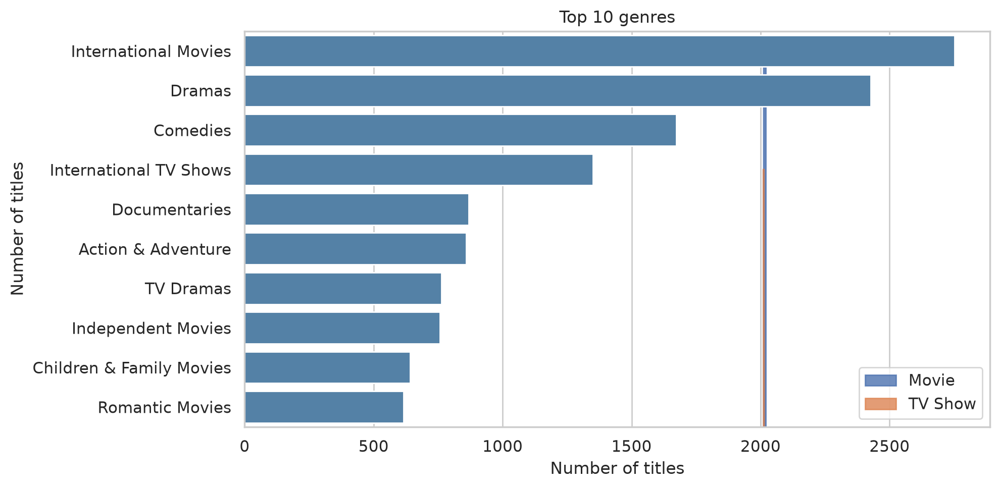
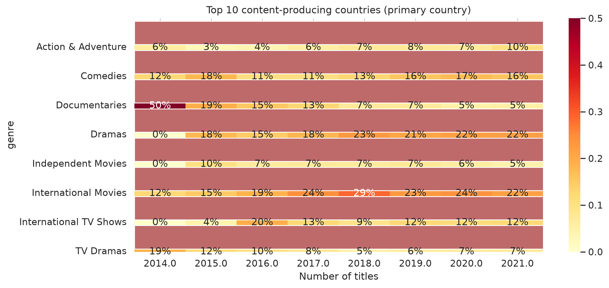
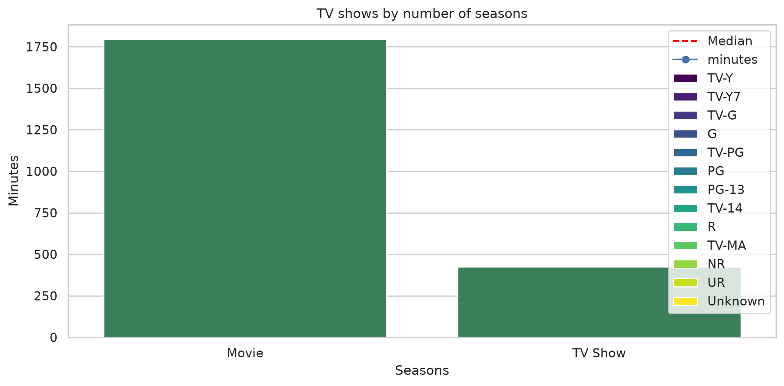

# Netflix Content Trend Analysis

Exploratory analysis of Netflix's catalog (8,807 titles) to answer a content acquisition question: **what does the catalog look like, how did it change, and what should be greenlit next?**

**Tools:** Python (pandas, matplotlib, seaborn) · SQL (SQLite) · Excel

## Key findings

| # | Insight | Evidence | Recommendation |
|---|---|---|---|
| 1 | International content is core | International Movies is the top genre (2,752 titles, ~45% of movies); International TV Shows is ~51% of TV shows; the US is the primary country for only ~37% of titles | Invest in regional originals (India, South Korea, Spain) |
| 2 | Short series dominate | 67% of TV shows have one season | Favor limited series; earn renewals |
| 3 | Family content is thin | 61% of titles are TV-MA or TV-14; Children & Family Movies are ~10% of movies | Commission family content (validate with viewing data) |

**Other facts:** 69.6% movies / 30.4% TV · annual additions rose 4.7x from 2016 (429) to 2019 (2,016) · median movie length 98 min · 63% of titles were added within 2 years of release.

### Charts





## Project structure

```
Project-1/
├── dataset/netflix_titles.csv     # Kaggle data
├── Notes/
│   ├── netflix_eda.py             # cleaning, 9 visualizations, memo numbers
│   ├── build_db.py                # builds netflix.db and runs the SQL
│   └── build_excel.py             # builds the Excel pivot workbook
├── sql/core_queries.sql           # 7 core aggregations
├── outputs/
│   ├── charts/                    # saved PNG charts
│   └── pivot_analysis.xlsx        # Excel pivot tables + charts
├── memo/Content Strategy Memo.docx               # content strategy report
└── README.md
```

## How to run

```bash
pip install pandas matplotlib seaborn openpyxl
python Notes/netflix_eda.py     # charts -> outputs/charts, numbers printed
python Notes/build_db.py        # SQLite DB + results of sql/core_queries.sql
python Notes/build_excel.py     # outputs/pivot_analysis.xlsx
```

Run all commands from the project root.

## Method notes and limitations

- Dataset: Kaggle "Netflix Movies and TV Shows". It has **no viewership data**, so findings describe the catalog, not audience behavior.
- `rating` is the **maturity rating** (e.g. TV-MA), not a quality score.
- Country analysis uses the first listed country; 831 titles (9%) have no country.
- Genre counts use one row per title-genre pair, so they add up to more than the number of titles.
- Years before 2015 have too few titles for reliable genre shares.

## Data source

[Netflix Movies and TV Shows, Kaggle (shivamb)](https://www.kaggle.com/datasets/shivamb/netflix-shows)
